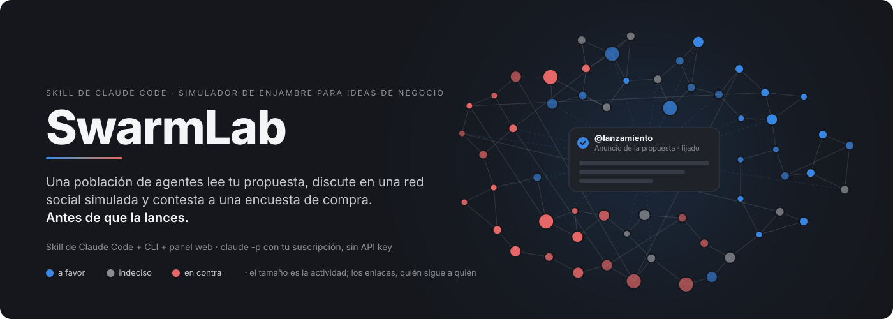
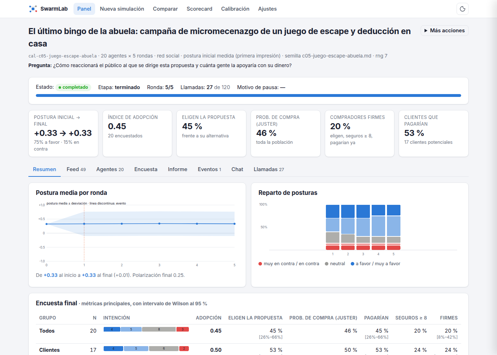
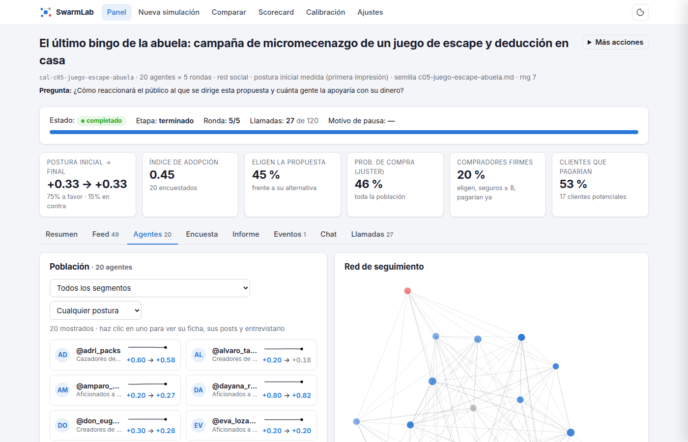
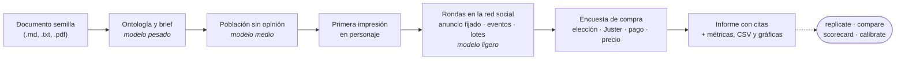
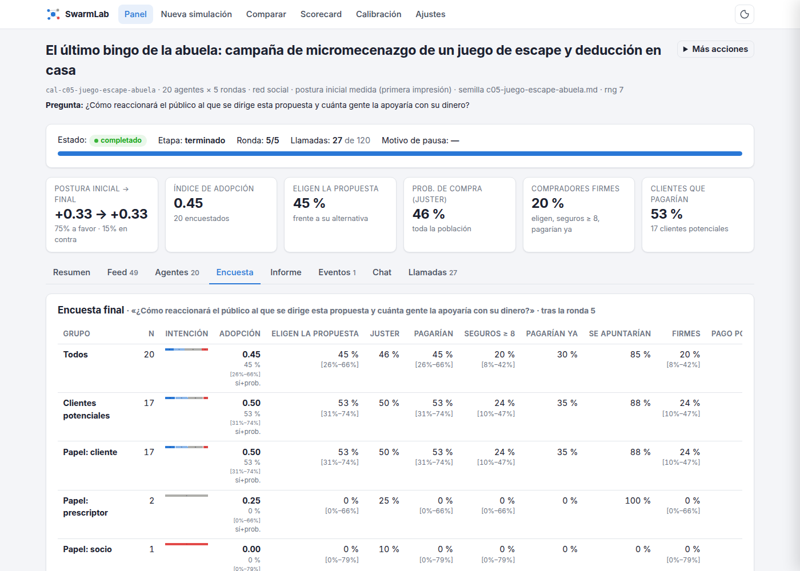
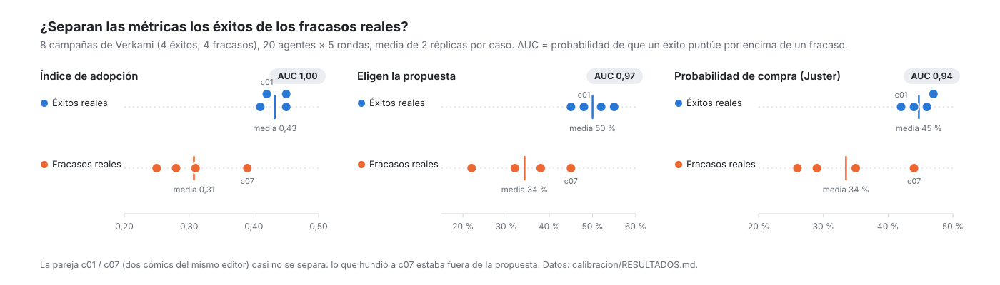

<p align="center">
  
</p>

<p align="center">
  Una <b>skill de Claude Code</b> que estresa tu idea de negocio, tu lanzamiento o tu política con una población<br>
  de agentes <b>antes</b> de ejecutarla. Con tu suscripción, sin API key. También como CLI y como panel web.
</p>

<p align="center">
  
  
  
  
</p>

---

## Qué hace

Le das un documento semilla (la idea, el plan, la nota de prensa) y SwarmLab:

1. **extrae** actores, intereses, hechos ancla y tensiones;
2. **genera una población** diversa de agentes con oficio, entorno, personalidad y memoria, y **mide
   la primera impresión** de cada uno en personaje;
3. **los hace convivir** varias rondas en una red social simulada: publican, responden, citan,
   comparten, siguen y cambian de opinión, con el anuncio de la propuesta fijado en la ronda 1 y los
   eventos «modo dios» que tú programes;
4. **les hace una encuesta de compra** con medidas difíciles de inflar: elección forzada frente a lo
   que usan hoy, escala de Juster, pago con su seguridad, precio máximo y compromiso inmediato;
5. **escribe un informe** con citas verificadas a posts y agentes, más métricas, CSV y gráficas.

Después puedes interrogar el informe, entrevistar a cualquier agente, **repetir la simulación** con
otras semillas para medir el ruido, **comparar versiones** con la misma población y **calibrar** las
métricas contra casos reales.

> **Para qué sirve y para qué no.** Sirve para encontrar objeciones, malentendidos, narrativas y
> segmentos receptivos u hostiles, y para comparar versiones de una idea. No predice cifras de ventas:
> los agentes son un modelo de lenguaje interpretando personajes. Antes de fiarte de una diferencia
> entre ideas, mira su intervalo de confianza y el ruido entre réplicas (sección
> [«Cómo leer los resultados»](#cómo-leer-los-resultados-y-cuándo-no-fiarse)).

## Índice

- [Empezar](#empezar): [como skill](#como-skill-de-claude-code) · [como CLI](#como-cli) · [panel web](#panel-web)
- [Cómo funciona](#cómo-funciona)
- [Qué obtienes](#qué-obtienes)
- [Cómo leer los resultados (y cuándo no fiarse)](#cómo-leer-los-resultados-y-cuándo-no-fiarse)
- [Réplicas, A/B y calibración](#réplicas-ab-y-calibración)
- [Comandos](#comandos)
- [Configuración](#configuración)
- [Llamadas y tiempo](#llamadas-y-tiempo)
- [Robustez](#robustez)
- [Desarrollo](#desarrollo)
- [Limitaciones](#limitaciones)

## Empezar

Hace falta, en Linux o macOS:

- Python 3.12 gestionado por [uv](https://docs.astral.sh/uv/);
- [Claude Code](https://code.claude.com) instalado y **logueado con tu suscripción**
  (`claude auth status` debe decir `authMethod: claude.ai`). Probado con Claude Code 2.1.306.
- No pongas `ANTHROPIC_API_KEY` en el entorno. SwarmLab la elimina igualmente del entorno de cada
  subprocess para no facturar por API.

### Como skill de Claude Code

Instala el plugin desde este repositorio (Claude Code 2.1.275 o posterior):

```text
/plugin install swarmlab --marketplace guglia001/swarmlab
```

Y, en cualquier proyecto, pídele a Claude que estrese una idea:

```text
/swarmlab:swarmlab idea.md ¿Cómo reaccionarán los autónomos y cuántos pagarían 29 €/mes?
```

La skill sabe lo que no es obvio: **estima antes de gastar cuota** y te lo dice, lanza con la postura
inicial medida y la encuesta, lee los resultados en el orden de fiabilidad que salió de la calibración,
replica antes de comparar y **no te vende la salida como una predicción de ventas**. El texto completo
está en [`skills/swarmlab/SKILL.md`](skills/swarmlab/SKILL.md); también puedes copiar esa carpeta a
`~/.claude/skills/` si prefieres no instalar el plugin. Los runs se guardan en el `runs/` del directorio
donde trabajas.

### Como CLI

```bash
git clone https://github.com/guglia001/swarmlab.git && cd swarmlab
uv sync                               # crea .venv con Python 3.12 y las dependencias
uv run swarmlab doctor                # comprueba binario, login, flags, aislamiento y concurrencia
cp config.example.toml config.toml    # opcional: modelos, concurrencia, topes…
```

El ejemplo es una gestoría con IA para autónomos (`examples/gestoria-ia.md`), con dos eventos
programados: un aviso de Hacienda en la ronda 4 y un influencer en la 6.

```bash
# 1) ¿Cuántas llamadas y cuánto tiempo?
uv run swarmlab estimate --seed examples/gestoria-ia.md --agents 30 --rounds 8

# 2) Simulación completa con encuesta final
uv run swarmlab run --seed examples/gestoria-ia.md \
    --prompt "¿Cómo reaccionarán autónomos y pymes?" \
    --agents 30 --rounds 8 --events examples/gestoria-events.yaml --survey --run-id gestoria

# 3) Explorar los resultados
uv run swarmlab show gestoria                    # estado y métricas principales
uv run swarmlab report gestoria --show           # regenerar y mostrar report.md
uv run swarmlab chat gestoria                    # /buscar <texto>, /agente <handle>, /post <id>
uv run swarmlab interview gestoria <handle>      # entrevista en personaje

# 4) ¿Es estable? Dos réplicas con otras semillas y la tabla con media ± desviación
uv run swarmlab replicate gestoria -n 2
uv run swarmlab scorecard 'gestoria*'

# 5) A/B: la versión B con la MISMA población (se vuelve a medir su primera impresión)
uv run swarmlab run --seed gestoria-b.md --prompt "…" --survey --personas-from gestoria --run-id gestoria-b
uv run swarmlab replicate gestoria-b -n 2        # cada réplica se empareja con la réplica de A
uv run swarmlab compare 'gestoria,gestoria-r*' 'gestoria-b*'
```

Sin red ni cuota: añade `--dry-run` y todo corre con respuestas deterministas (`FakeClaudeCLI`).

### Panel web

```bash
uv run swarmlab web        # http://127.0.0.1:8008
```

Todo lo de la CLI, con el run en vivo y la red social a la vista. Sin build ni Node: FastAPI, HTMX y
gráficas SVG generadas en el servidor que siguen tu tema claro u oscuro.

<p align="center"></p>

- **Panel** con indicadores, búsqueda y filtros; marca dos runs para compararlos o varios para un
  scorecard.
- **Nueva simulación**: sube la semilla, pégala o elige un ejemplo; eventos en YAML; población
  reutilizada para A/B; **estimación de llamadas y tiempo que se actualiza mientras rellenas**.
- **Cola de ejecución**: como mucho `WEB_PARALLEL_RUNS` runs a la vez (2 por defecto); el resto
  espera. La encuesta y el informe también se encolan.
- **Página del run por pestañas**, que se recargan solas al cerrar cada ronda:
  - *Resumen*: postura por ronda con eventos marcados, reparto de posturas, segmentos, quién movió la
    conversación, narrativas y ronda a ronda;
  - *Feed*: la red social simulada, con filtros por ronda, tipo, eco y texto;
  - *Agentes*: la población con su trayectoria, la **red de seguimiento** coloreada por postura y una
    ficha lateral por agente con su primera impresión, lo que pensó en cada ronda, su respuesta a la
    encuesta, sus posts y la **entrevista en personaje**;
  - *Encuesta*: todos los bloques con intervalos, la curva de precio, lo que frena y lo que convencería,
    y las respuestas una a una;
  - *Informe*: el informe con sus gráficas, exportación a PDF y descargas (`report.md`, `dossier.md`,
    `metrics.json`, `personas.json`); *Eventos*: inyectar un evento «modo dios» en una ronda futura;
    *Chat* con el analista; *Llamadas*: el registro de `claude -p` por modelo y propósito.
- **Comparar**, **Scorecard** y **Calibración** (con guardado del ruido de referencia) y **Ajustes** con
  la comprobación de la instalación.

<p align="center"></p>

## Cómo funciona



1. **Ontología y brief** (modelo pesado): entidades, relaciones, hechos ancla, tensiones y segmentos
   de público con su peso.
2. **Población** (modelo medio). En el modo por defecto (`STANCE_MODE=impresion`) las personas se
   generan **sin opinión** sobre la propuesta: vida, oficio, entorno, edad y lo que usan hoy. Después
   cada una lee la propuesta y da su **primera impresión en personaje** (reacción, motivo, implicación
   y postura) antes de hablar con nadie, así que la distribución inicial depende de la idea. Con
   `--stance-mode cuotas` la postura se fija con un plan de cuotas (≥ 15 % escépticos, ≥ 10 % poco
   interesados): útil como test de estrés para garantizar objeciones, pero entonces la postura inicial
   no dice nada de la idea.
3. **Rondas** (modelo ligero, por lotes). La ronda 1 empieza con el anuncio de la propuesta fijado en
   todos los feeds (`LAUNCH_POST`); los eventos del YAML aparecen en su ronda. Cada agente activo ve su
   feed y decide qué hace y cómo cambia su postura. El estado de la ronda se congela y se confirma al
   cerrarla; la memoria se resume cada 3 rondas.
4. **Encuesta final** (`--survey`, modelo medio), en personaje:
   - elección forzada entre la propuesta, su alternativa actual y nada;
   - escala de Juster 0–10;
   - ¿pagaría? y con qué seguridad;
   - precio máximo frente al de la propuesta;
   - ¿pagaría ya una señal?
5. **Informe** (modelo pesado) a partir de un dossier compacto, con citas verificadas a posts y
   agentes.

## Qué obtienes

**Una tabla por idea**, con las réplicas agregadas y el intervalo de confianza de cada porcentaje.
Así resume `swarmlab scorecard` (con menos columnas) dos campañas del banco de calibración: un juego
de mesa que consiguió el 160 % de su objetivo y otro que se quedó en el 24 %:

| Idea (runs) | Postura inicial → final | Adopción | Eligen la propuesta | Prob. de compra (Juster) | Compradores firmes | Clientes que pagarían | Precio máx. mediano |
|---|---|---|---|---|---|---|---|
| c05 juego de escape (×2) | +0,29 → +0,32 | **0,45** ± 0,00 | **45 %** ± 0 | **46 %** ± 0 | 20 % ± 0 | 59 % ± 8 | ≈30 € (ref. 30) |
| c03 juego educativo (×2) | +0,11 → +0,07 | 0,25 ± 0,04 | 22 % ± 4 | 26 % ± 1 | 0 % ± 0 | 30 % ± 2 | ≈20,5 € (ref. 25) |

**Lo más útil suele ser lo cualitativo**: la objeción con más eco, el mejor y el peor segmento, las
narrativas y las entrevistas. Del mismo run:

> **Objeción con más eco** · `p0034` @vane_desde_el_pueblo: «Diseño cerrado no es entregado. Cinco
> meses tras el cierre y sin fecha firme. Yo no pago por una demo bonita, pago por recibir el pedido.»
> **Mejor segmento:** mecenas habituales del editor (+0,86). **Peor:** escépticos de los plazos y del
> micromecenazgo (−0,61).

<p align="center"></p>

**Y todo el detalle en `runs/<run_id>/`:**

| Fichero | Contenido |
|---|---|
| `scenario_brief.md` | brief del escenario: propuesta, hechos ancla, actores, tensiones, segmentos |
| `graph.json`, `charts/knowledge_graph.png` | grafo de entidades y relaciones (networkx) |
| `personas.json` | población: Big Five, valores, lo que usan hoy, primera impresión, postura, actividad, segmento |
| `swarm.db` | todo el estado en SQLite: posts, likes, follows, acciones, decisiones, memoria, encuesta, checkpoints |
| `metrics/*.csv`, `metrics/metrics.json` | postura por ronda, agentes, posts, narrativas, influencers |
| `charts/*.png` | evolución de la postura, distribución, actividad, polarización, influencers |
| `dossier.md` | dossier compacto que se le pasa al modelo pesado |
| `report.md` (`report.pdf` con `swarmlab export-pdf`) | informe de predicción con citas verificadas |
| `llm_calls.jsonl` | una línea por llamada: modelo, tokens, duración, arranque, coste nocional, resultado |

## Cómo leer los resultados (y cuándo no fiarse)

Para saber qué cifras merecen atención, `swarmlab calibrate` se pasó sobre 8 campañas reales de
crowdfunding con desenlace conocido (4 éxitos y 4 fracasos, en parejas del mismo tipo de producto) y
sobre 12 ideas × 2 réplicas para medir el ruido. Los detalles están en
[`calibracion/RESULTADOS.md`](calibracion/RESULTADOS.md).

<picture>
  <source media="(prefers-color-scheme: dark)" srcset="docs/calibracion-dark.svg">
  
</picture>

| Señal (toda la población salvo que se diga) | AUC éxito/fracaso | Estabilidad (ICC) | Uso |
|---|---|---|---|
| **Índice de adopción** (sí = 1, probablemente = 0,6, quizá = 0,25) | 1,00 | 0,84 | Métrica principal |
| **Elige la propuesta** frente a lo que hace hoy y a nada | 0,97 | 0,65 | Métrica principal |
| **Probabilidad de compra** (escala de Juster, 0–10) | 0,94 | 0,93 | Métrica principal |
| Primera impresión y postura final (modo impresión) | 0,84–0,88 | 0,78–0,80 | Cómo cae en frío y si la conversación la mueve |
| Compradores firmes / pago con seguridad ≥ 8 | 0,88 | 0,84–0,86 | Casi siempre 0 %: si sale > 0, señal rara y buena |
| Clientes: pagarían, eligen, sí + probablemente | 0,75–0,88 | 0,09–0,46 | Ruidosas (6–17 clientes por run): no ordenar ideas con ellas |
| % a favor / en contra **en modo cuotas** | – | – | **No es un resultado**: lo fija el plan de cuotas |
| **Objeciones, malentendidos y narrativas** | – | – | Lo más accionable: posts con más eco, entrevistas |

AUC: probabilidad de que un éxito real puntúe por encima de un fracaso real (0,5 = azar). ICC: parte
de la variación entre runs que se debe a la idea y no al azar de la simulación.

El banco es pequeño y de una sola categoría (productos culturales de 20–30 €). En otras categorías
(B2B, tickets altos, servicios) las cifras absolutas no están calibradas: compara ideas parecidas
entre sí.

- **«Clientes»** son el público al que se dirige la oferta, lo compren o no. No son «los que lo
  comprarían»: esa definición inflaría el «% de clientes que pagarían».
- **Mira el n y el intervalo.** El scorecard da el intervalo de Wilson al 95 %: con 9 clientes, un
  «100 % pagaría» es compatible con un 70 %, y diferencias de 20 puntos entre dos ideas son ruido.
- **Diferencias mínimas que merece la pena tomar en serio con 2 réplicas por idea** (20 agentes ×
  5 rondas): unos 9 puntos de probabilidad de compra, 0,11 de adopción y 25 puntos de elección.
- **Repite antes de comparar.** Los agentes de un run no son independientes (deciden por lotes y se
  influyen), así que la unidad de réplica es el run. `replicate` da réplicas con otras semillas;
  `compare` usa una t de Welch sobre ellas, y con un solo run por lado usa el ruido medido por
  `calibrate` o no da veredicto.
- **Registra predicciones y compáralas con la realidad.** Apunta lo que dice SwarmLab antes de cada
  piloto y lo que pasó después. Con el tiempo, ese registro es lo que dice cuánto pesar la herramienta.

## Réplicas, A/B y calibración

```bash
uv run swarmlab replicate <run> -n 2                      # <run>-r2, <run>-r3 con semillas +1, +2
uv run swarmlab replicate <run> -n 2 --same-population    # solo el ruido de la dinámica, misma población
uv run swarmlab scorecard 'idea*' final-x --out tabla.md  # tabla por idea (réplicas agregadas, IC de Wilson)
uv run swarmlab compare 'a,a-r2,a-r3' 'b*'                # A/B con réplicas: Welch por métrica
uv run swarmlab calibrate 'cal-*' --outcomes calibracion/casos.toml --out calibracion.md
```

Los runs se pueden dar como ids, listas separadas por comas o patrones entre comillas. `calibrate`
responde a dos preguntas: qué parte de la variación entre runs se debe a la idea (ICC) y qué
diferencia mínima se puede detectar; y, con `--outcomes`, si las métricas separan casos reales de
éxito y de fracaso (AUC con p de permutación). Guarda el ruido medido en
`runs/_calibration/ruido.json`, que `compare` usa para juzgar runs sueltos. En el panel web, todo esto
está en **Comparar**, **Scorecard** y **Calibración**.

Para repetir la calibración con el banco incluido (16 runs, unas 26 llamadas y 5 minutos cada uno):

```bash
bash calibracion/lanzar.sh cal 2 calibracion/casos/c0*.md
uv run swarmlab calibrate 'cal-*' --outcomes calibracion/casos.toml
```

Las semillas del banco están anonimizadas y escritas como antes del lanzamiento; los desenlaces
reales están solo en `casos.toml`, que no llega a los agentes.

## Comandos

| Comando | Qué hace |
|---|---|
| `doctor` | Comprueba que `claude` está instalado, logueado, aislado y responde; muestra versión y flags |
| `estimate` | Llamadas, tiempo y tokens aproximados para una simulación |
| `run` | Simulación completa: ontología → personas → rondas → encuesta → informe |
| `resume` | Continúa un run pausado o interrumpido desde su último checkpoint |
| `inject` | Añade un evento «modo dios» a un run pausado, para una ronda que aún no se ha jugado |
| `survey` | (Re)hace la encuesta final en personaje |
| `report` | (Re)genera `report.md`, métricas CSV/JSON y gráficas |
| `show`, `list` | Estado y métricas principales de un run; simulaciones guardadas |
| `chat` | Conversa con el analista del informe (`/buscar`, `/agente`, `/post`) |
| `interview` | Entrevista en personaje a un agente, reanudando la sesión entre preguntas |
| `replicate` | Repite un run con otras semillas: mismo documento, pregunta, eventos y configuración |
| `scorecard` | Tabla de resultados de varios runs; agrupa las réplicas de una idea |
| `compare` | A/B entre dos ideas o versiones, con réplicas si las hay: métricas, p, segmentos y narrativas |
| `calibrate` | Ruido entre réplicas (ICC) y, con `--outcomes`, AUC frente a la realidad |
| `export-pdf` | Exporta `report.md` con gráficas a PDF |
| `web` | El panel web (FastAPI + HTMX) en http://127.0.0.1:8008 |

Opciones útiles de `run`:

- `--survey`: encuesta final de compra en personaje.
- `--stance-mode impresion|cuotas`: postura inicial medida o fijada (ver «Cómo funciona»).
- `--personas-from <run_id>`: reutiliza la misma población para comparar dos versiones de una idea.
- `--no-report-llm`: solo métricas y encuesta, sin narrativas ni informe del modelo pesado. Ahorra 2
  llamadas y unos 4 minutos; es lo que usan los runs de calibración.
- `--agents-per-call 1`: máxima independencia entre agentes, a cambio de más llamadas.
- `--interactive`: tras cada ronda puedes escribir un evento para la siguiente.
- `--until ontology|personas`: parar tras una etapa.
- `--platform forum`, `--max-calls N`, `--rng-seed N`.

## Configuración

`config.example.toml` documenta todas las claves. Las más importantes:

| Clave | Por defecto | Para qué |
|---|---|---|
| `MODEL_HEAVY` / `MODEL_MEDIUM` / `MODEL_LIGHT` | opus / sonnet / haiku | ontología e informe / personas, impresión, encuesta, resúmenes / decisiones y memoria |
| `STANCE_MODE` | `impresion` | postura inicial medida (`impresion`) o fijada por cuotas (`cuotas`) |
| `SURVEY` | `false` | encuesta final de compra (también `--survey`) |
| `REPORT_LLM` | `true` | `false` = solo métricas y encuesta |
| `LAUNCH_POST` | `true` | la ronda 1 empieza con el anuncio de la propuesta (sin él, la conversación puede no arrancar) |
| `AGENTS_PER_CALL` | 6 | agentes por llamada de decisión (1 = independencia máxima) |
| `MAX_CONCURRENCY` | 3 | procesos `claude -p` simultáneos por run |
| `WEB_PARALLEL_RUNS` | 2 | runs simultáneos desde el panel web; el resto espera en cola |
| `MAX_CALLS_PER_RUN` | 600 | tope duro de subprocesses por run |

Precedencia: valores por defecto < `config.toml` < `.env` < variables `SWARMLAB_<CLAVE>` < opciones de
la CLI. `examples/cribado.toml` es una configuración barata para cribar muchas ideas (sin opus,
20 agentes × 5 rondas) y `calibracion/calibracion.toml`, la de medición. Los runs anteriores a la
primera impresión se leen como `cuotas`.

## Llamadas y tiempo

Cada `claude -p` tarda ~1,5 s en arrancar y consume cuota de tu suscripción, así que los agentes
deciden por lotes (`AGENTS_PER_CALL=6` por defecto) y la memoria se resume cada 3 rondas. La primera
impresión añade una llamada por cada 10 agentes y la encuesta, otra.

| Simulación | Llamadas | Tiempo |
|---|---|---|
| 30 agentes × 8 rondas, ejemplo de la gestoría (medido, modo cuotas) | 44 (estimado 43) | ~8,5 min |
| 20 agentes × 5 rondas, cribado (`examples/cribado.toml`, medido, modo cuotas) | 19–23 (+2 con `--survey`) | ~4–6 min |
| 20 agentes × 5 rondas, medición (`calibracion/calibracion.toml`: impresión, encuesta, sin informe; medido en 24 runs) | 25–28 | ~5,2 min (2 en paralelo) |
| `--dry-run` 30 × 8 | 0 reales | ~5 s |

`swarmlab estimate` (y el panel, mientras rellenas el formulario) da la cifra para tu caso. Si supera
`MAX_CALLS_PER_RUN`, pide confirmación.

## Robustez

- **Pausa y reanudación.** El estado de cada ronda se confirma en una transacción al cerrarla. Un
  Ctrl+C pausa al acabar la ronda en curso; dos Ctrl+C cortan ya. `swarmlab resume <run_id>` sigue
  desde el último checkpoint y reutiliza las llamadas ya pagadas de la ronda interrumpida.
- **Límite de uso de la suscripción.** Se detecta por el mensaje del CLI, se pausa con checkpoint y se
  escribe un informe provisional sin LLM. **Tope de llamadas:** se para antes de una ronda que no cabe
  y se reservan llamadas para el informe.
- **Aislamiento.** Cada `claude -p` corre con `--safe-mode --setting-sources ""`, sin herramientas y
  desde un directorio vacío: no carga tus hooks, plugins ni ajustes. Las llamadas de un solo uso no
  guardan sesión; solo las entrevistas y el chat la reanudan entre preguntas.
- Reintentos con backoff exponencial y jitter, timeout por llamada, validación pydantic con
  reintentos que devuelven el error al modelo, semáforo de concurrencia.
- Las decisiones, impresiones y respuestas de encuesta de cada lote llevan un schema con los
  `agent_id` del lote como enum y exactamente un elemento por agente: el CLI rechaza ids inventados o
  agentes olvidados.

Los detalles (flags verificados de `claude -p`, decisiones de diseño y de medición) están en
[`DECISIONS.md`](DECISIONS.md).

## Desarrollo

```bash
uv run pytest          # 118 tests; ninguno llama al CLI real (FakeClaudeCLI / runner falso)
uv run ruff check swarmlab tests && uv run ruff format --check swarmlab tests
claude plugin validate .   # manifiesto del plugin y frontmatter de la skill
```

Módulos: `engine` (etapas, rondas, checkpoints), `personas` (población y primera impresión), `agent`
(decisiones por lotes), `survey` (encuesta y medidas de compra), `stats` (Wilson, Welch, ICC, AUC, sin
dependencias), `scorecard` (tabla, ruido y calibración), `compare` (A/B), `replicate` (réplicas),
`report` (dossier e informe), `llm` (backend `claude -p` y `FakeClaudeCLI`), `web` (FastAPI + HTMX;
`web/charts` dibuja las gráficas SVG), `skills/swarmlab` (la skill) y `.claude-plugin/` (manifiesto y
marketplace del plugin).

## Limitaciones

- Los agentes son un modelo de lenguaje interpretando personajes. Reflejan sesgos del modelo y del
  documento semilla, no datos de mercado, y su intención de compra suele ser más generosa que la de la
  gente real, incluso con las medidas estrictas.
- La validez externa no está demostrada en general. En el banco de 8 campañas reales las métricas
  principales separaron éxitos de fracasos (AUC 0,94–1,00), pero son pocos casos y de una sola
  categoría, y en la pareja de dos cómics del mismo editor la simulación no vio la diferencia: venía de
  la audiencia, no de la propuesta. Amplía el banco antes de apoyar decisiones caras en las cifras.
- Agrupar agentes por llamada abarata mucho la simulación pero introduce correlación entre ellos;
  `--agents-per-call 1` la elimina a cambio de más llamadas.
- Las poblaciones pequeñas (20–30 agentes, 4–17 clientes potenciales) dan resultados ruidosos: usa
  réplicas, compara versiones con la misma población (`--personas-from`) y mira los intervalos.
- Los términos de consumidor de Anthropic restringen el uso comercial y automatizado de las
  suscripciones Pro/Max (en la UE: «Non-commercial use only»). Para ofrecer simulaciones a terceros
  hace falta la API o un plan comercial.
